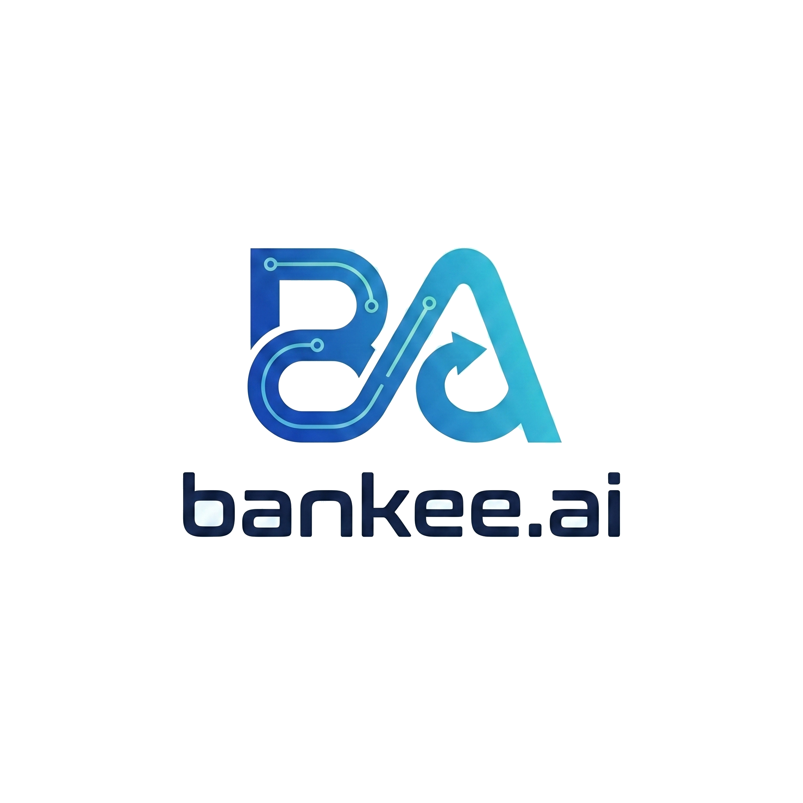

# Bankee SDK

> Scaffold for connecting a smart device to payment rails through one integration surface.

Wallet Bridge runs end to end on partner test systems today. No real money moves yet. A limited EUR to Alipay pilot is planned for early 2027, subject to a licensed partner and regulatory approval.

This repository does not move money. Payment and protocol handlers in the tree are placeholders.

## Supported Payment Rails

| Protocol | Status | Description |
|----------|--------|-------------|
| Wero / APMs | Sandbox / test | European instant payments on partner test systems |
| Open Banking | Sandbox / test | Account-to-account transfers on partner test systems |
| Visa / Mastercard | Sandbox / test | Card payments on partner test systems |
| Google AP2 | Planned | Agent Payments Protocol. No working implementation in this repo |
| Coinbase x402 | Planned | HTTP-native machine payments. No working implementation in this repo |
| MPP | Planned | Machine Payments Protocol. No working implementation in this repo |
| OpenAI ACP | Planned | Agentic Commerce Protocol. No working implementation in this repo |
| A2A | Planned | Agent-to-agent communication. No working implementation in this repo |
| Digital Euro (CBDC) | Planned | Central bank digital currency |

`Sandbox / test` matches Wallet Bridge on partner test systems. It does not mean this repository can execute that rail. `Planned` means this repository has no working implementation (handlers are stubs, or the referenced protocol files are absent).

## Installation

`@bankee/sdk` is not published to npm. There is no supported install command.

Installing from this repository does not work either. The tree has no `package.json`, and `src/index.ts` imports `./sdk`, which is not present. The TypeScript sources are a scaffold for review.

## Quick Start

The samples below describe the intended API. They do not run against a published package, and they do not move money.

```typescript
import { BankeeSDK } from '@bankee/sdk';

const bankee = new BankeeSDK({
  apiKey: process.env.BANKEE_API_KEY,
  environment: 'sandbox',
});

// Prefer a rail. Execution is not implemented in this repository.
const payment = await bankee.payments.create({
  amount: 1000, // in minor units (£10.00)
  currency: 'GBP',
  rails: ['wero', 'open_banking', 'card'], // preference order
  device: {
    type: 'wearable',
    nfc: true,
    secureElement: true,
  },
});
```

## Agentic Payments

```typescript
import { BankeeSDK } from '@bankee/sdk';

const bankee = new BankeeSDK({
  apiKey: process.env.BANKEE_API_KEY,
  environment: 'sandbox',
});

// Intended shape only. Protocol handlers in this repo are not implemented.
const agentPayment = await bankee.agentic.createPayment({
  protocol: 'ap2',       // Google AP2, x402, mpp, or acp
  amount: 500,
  currency: 'USDC',
  approval: 'auto',      // or 'human-in-loop'
  agent: {
    id: 'inventory-agent-01',
    capabilities: ['initiate_payment', 'negotiate_price'],
  },
});
```

## Architecture

```
┌─────────────────────────────────────────────────┐
│                  Your Application                │
└─────────────────────┬───────────────────────────┘
                      │
┌─────────────────────▼───────────────────────────┐
│                  Bankee SDK                      │
│  ┌──────────┐ ┌──────────┐ ┌──────────────────┐ │
│  │  Device  │ │ Payment  │ │    Agentic       │ │
│  │ Manager  │ │  Router  │ │    Gateway       │ │
│  └──────────┘ └──────────┘ └──────────────────┘ │
└─────────────────────┬───────────────────────────┘
                      │
        ┌─────────────┼─────────────┐
        │             │             │
   ┌────▼────┐  ┌─────▼────┐  ┌────▼──────┐
   │  Wero   │  │   Open   │  │  Agentic  │
   │  Cards  │  │ Banking  │  │ Protocols │
   └─────────┘  └──────────┘  └───────────┘
```

The diagram is the intended shape. Routing in this repository selects a rail label and does not settle a payment.

## Device Support

- **NFC** — contactless payments on any NFC-enabled device
- **BLE** — Bluetooth Low Energy for proximity payments
- **Secure Element** — hardware-backed key storage and cryptographic operations
- **APDU** — Application Protocol Data Unit command and response handling

Supported form factors: phones, smartwatches, wearables, smart rings, IoT devices, any NFC-capable hardware.

## Protocol notes

See [`bankee-ai/protocol-integrations`](https://github.com/bankee-ai/protocol-integrations) for separate notes on these protocols. Working protocol handlers are not in this repository.

## Compliance

Wallet Bridge runs end to end on partner test systems today. No real money moves yet. A limited EUR to Alipay pilot is planned for early 2027, subject to a licensed partner and regulatory approval.

- GDPR compliant
- Bank-level AES-256 encryption

## Documentation

Full documentation, API reference, and integration guides: [docs.bankee.ai](https://bankee.ai)

## Support

- **Integration support**: mohammed@bankee.ai
- **Commercial enquiries**: Jonathan@bankee.ai
- **Partnership**: naved@bankee.ai

## License

Proprietary — © 2025 Bankee Technologies OÜ. SDK reference implementations in `/examples` are MIT licensed.
